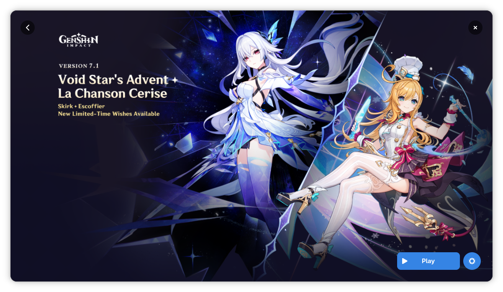
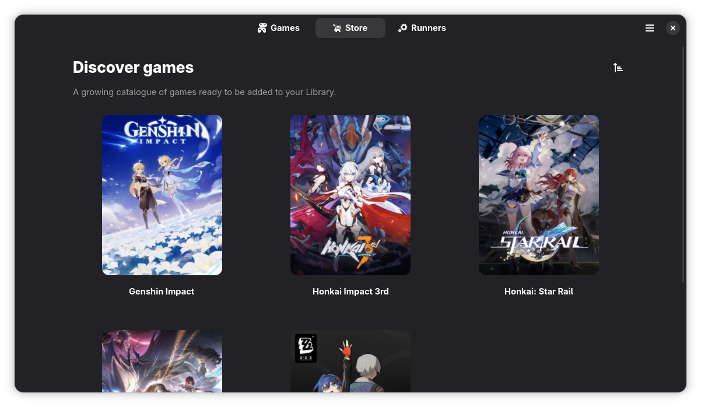
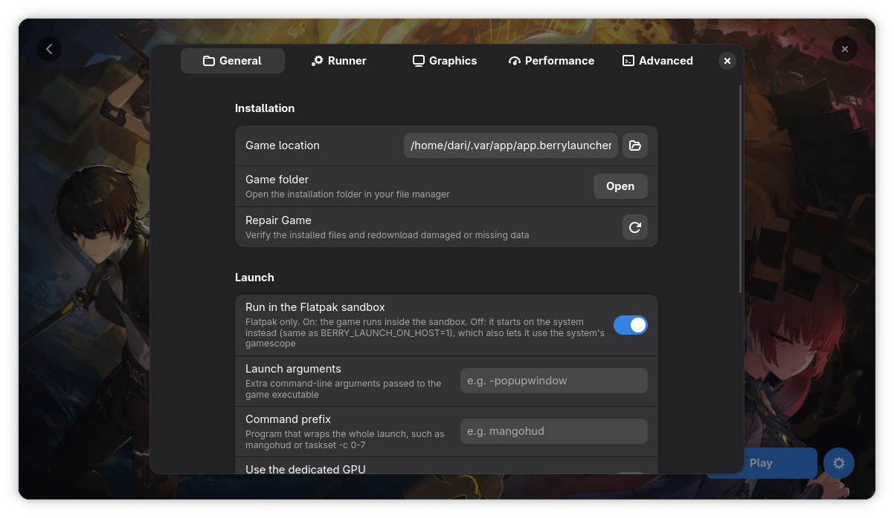
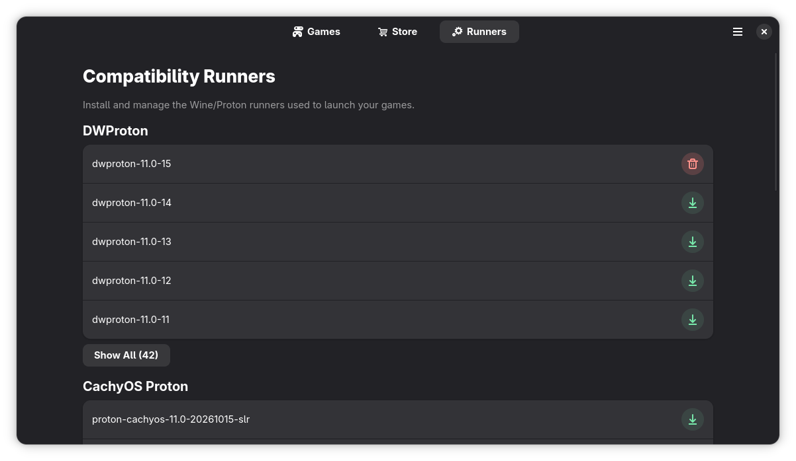

<div align="center">

# Berry Launcher

**A native Linux launcher for anime games, built with Rust, GTK 4 and libadwaita.**

  

</div>

> [!IMPORTANT]
> **AI-assisted project.** AI tools helped develop features, write documentation and optimize code. Please review the source code, and report any problems through the issue tracker.

Berry Launcher is an independent Linux desktop application. It helps you install, manage and launch anime games. It runs them through Proton-based compatibility runners and gives each game its own settings.

Current release: **1.0.0**

## Quick start

Berry Launcher is for Linux players who want one app to install and run supported anime games. To try it with the Flatpak bundle:

1. Download `berrylauncher.flatpak` from the [1.0.0 release page](https://github.com/A-Berry-Team/BerryLauncher/releases/tag/1.0.0). To build it yourself, follow [Building the Flatpak bundle](build-aux/README.md#distributable-bundle-flatpak).
2. Install it:

   ```sh
   flatpak install --user ./berrylauncher.flatpak
   ```

3. Start it:

   ```sh
   flatpak run app.berrylauncher.berry
   ```

4. Open the store, pick a game and install it.
5. If a game needs a different compatibility runner, change it in the game's settings.

## Screenshots

<table>
  <tr>
    <td width="50%" align="center">
      <br>
      <sub>Game page</sub>
    </td>
    <td width="50%" align="center">
      <br>
      <sub>Store</sub>
    </td>
  </tr>
  <tr>
    <td width="50%" align="center">
      <br>
      <sub>Game settings</sub>
    </td>
    <td width="50%" align="center">
      <br>
      <sub>Compatibility runners</sub>
    </td>
  </tr>
</table>

## Features

- **Game library and store:** browse and manage supported games.
- **Installation and maintenance:** install, update and repair game files.
- **Compatibility runners:** manage supported Proton-based runners.
- **Per-game settings:** configure runners, GameMode, DXVK HUD, FSR, Gamescope, environment variables and launch options.
- **Launch management:** configure window behavior and game execution.
- **GNOME integration:** GTK 4, libadwaita, desktop entries and application metadata.
- **Localization:** translations powered by Project Fluent, with English as the fallback.

## Supported games

The built-in catalog currently includes:

| Game | Developer | Publisher |
| --- | --- | --- |
| [Genshin Impact](https://genshin.hoyoverse.com/) | miHoYo | HoYoverse |
| [Honkai: Star Rail](https://hsr.hoyoverse.com/) | miHoYo | HoYoverse |
| [Zenless Zone Zero](https://zenless.hoyoverse.com/) | miHoYo | HoYoverse |
| [Honkai Impact 3rd](https://honkaiimpact3.hoyoverse.com/) | miHoYo | HoYoverse |
| [Wuthering Waves](https://wutheringwaves.kurogames.com/) | Kuro Games | Kuro Games |

Whether a game works can depend on the game itself, the runner, your graphics stack and upstream changes. Berry Launcher is not a publisher-provided launcher.

## Compatibility runners

A *runner* is a Proton-based tool that lets Windows games run on Linux. Berry Launcher currently offers these runner providers:

| Provider in Berry Launcher | Upstream source |
| --- | --- |
| DWProton | [dawn-winery/dwproton](https://dawn.wine/dawn-winery/dwproton) |
| CachyOS Proton | [CachyOS/proton-cachyos](https://github.com/CachyOS/proton-cachyos) |
| Proton Wineland | [nanomatters/proton-cachyos](https://github.com/nanomatters/proton-cachyos) |
| GE-Proton | [GloriousEggroll/proton-ge-custom](https://github.com/GloriousEggroll/proton-ge-custom) |

Runners are third-party projects with their own licenses and terms. For release notes, compatibility information and support, see each upstream repository.

## Installation

The first Flatpak release is distributed as `berrylauncher.flatpak`. Download it from the [1.0.0 release page](https://github.com/A-Berry-Team/BerryLauncher/releases/tag/1.0.0), then install and start it like this:

```sh
flatpak install --user ./berrylauncher.flatpak
flatpak run app.berrylauncher.berry
```

To build the bundle yourself, see [Building the Flatpak bundle](build-aux/README.md#distributable-bundle-flatpak).

### Flatpak sandbox

By default, the Flatpak build runs games **inside its own sandbox**. If you turn off the per-game option **Run in the Flatpak sandbox**, the game runs on the host system instead.

Where the game runs decides which gamescope is used:

| Package / switch | gamescope used | What you need |
| --- | --- | --- |
| Native | The system's | `sudo dnf install gamescope` (or your distribution's equivalent) |
| Flatpak, **Run in the Flatpak sandbox** off | The host's | The same system package |
| Flatpak, **Run in the Flatpak sandbox** on (default) | The Flatpak extension | `flatpak install flathub org.freedesktop.Platform.VulkanLayer.gamescope` |

For permissions and build configuration, see the Flatpak manifests: [`app.berrylauncher.berry.json`](app.berrylauncher.berry.json) (development) and [`build-aux/flatpak/app.berrylauncher.berry.release.json`](build-aux/flatpak/app.berrylauncher.berry.release.json) (release).

## Building from source

### Requirements

- Rust (stable) and Cargo
- Meson 1.0 or newer, and Ninja
- Python 3
- GTK 4 and libadwaita development libraries
- A C toolchain and native dependencies, including OpenSSL and xz
- WebKitGTK 6, libwebp and dav1d development libraries (these are what the project's CI installs; see [`.github/workflows/ci.yml`](.github/workflows/ci.yml))

### Build

`crates/berry-installer` is a git submodule, so clone with submodules:

```sh
git clone --recurse-submodules https://github.com/A-Berry-Team/BerryLauncher.git
cd BerryLauncher
```

If you already cloned without `--recurse-submodules`, run `git submodule update --init`.

Meson drives the desktop application build. It calls Cargo and compiles the GResource bundle (the file that packs the app's images into the binary):

```sh
meson setup build
meson compile -C build
```

For code checks, tests, release steps and dependency notes, see [docs/DEVELOPMENT.md](docs/DEVELOPMENT.md). For the project structure, see [docs/ARCHITECTURE.md](docs/ARCHITECTURE.md).

## Data and configuration

Berry Launcher stores your data here:

| Install type | Location |
| --- | --- |
| Native | `~/.local/share/BerryLauncher/` |
| Flatpak | `~/.var/app/app.berrylauncher.berry/data/BerryLauncher/` |

Inside that folder you will find `runners/`, `prefixes/`, `extras/`, `logs/` and `preferences.ini`.

> [!WARNING]
> Back up your data before you change or delete files by hand. Removing a game from the library may delete its managed directory.

## Localization

Translations use [Project Fluent](https://projectfluent.org/). The files live in `crates/berry-locale/i18n/<language-code>/berrylauncher.ftl`. Use the English file as your reference, and keep message IDs, variables and selectors unchanged.

For the full guide, see the [`berry-locale` README](crates/berry-locale/README.md).

## Troubleshooting

- **A game fails to launch:** try another runner, and read `logs/<game-id>.log` in the data directory.
- **A runner download fails:** check your network connection and the upstream release page.
- **Installation problems:** use the repair option and check that you have enough disk space.
- **Graphics problems:** check Vulkan support, your GPU drivers and runner compatibility.

To report a bug, open an [issue](https://github.com/A-Berry-Team/BerryLauncher/issues) and attach the relevant game log. Remove any sensitive information first.

## Frequently asked questions

**Is Berry Launcher official?**
No. It is an independent community project and is not affiliated with any game publisher.

**Was AI used?**
Yes. AI assisted with feature development, documentation and code optimization. See the note at the top of this page.

**Where are games and settings stored?**
See [Data and configuration](#data-and-configuration).

**How do I add or fix a translation?**
See [Localization](#localization).

## Contributing

Issues and pull requests are welcome.

- Follow the existing Rust style.
- Run `cargo fmt --check` and the relevant tests. See [docs/DEVELOPMENT.md](docs/DEVELOPMENT.md) for the full list of checks.
- Keep Fluent message IDs and variables unchanged.
- Do not commit game data, downloaded runners, credentials or build artifacts.
- For larger changes, open an issue first to discuss them.

## Related projects

- [Twintail Launcher](https://github.com/TwintailTeam/TwintailLauncher): multi-platform launcher for anime games.
- [Anime Games Launcher](https://github.com/an-anime-team/anime-games-launcher): community launcher for anime games on Linux.
- [UMU](https://github.com/Open-Wine-Components/umu-launcher): unified launcher/runtime integration for running Windows games on Linux.
- [Proton](https://github.com/ValveSoftware/Proton): Valve's compatibility tool for Windows games.

## License and disclaimer

Berry Launcher is licensed under **GPL-3.0-or-later**. See [LICENSE](LICENSE).

`berry-installer` is a separate repository, linked here as a git submodule (`crates/berry-installer`). It is original code. Its design and its knowledge of the server protocol come from `fischl-rs` (GPL-3.0; see the `LICENSE` of that repository).

This is an independent community project. It is not affiliated with or endorsed by HoYoverse, Kuro Games, Valve or the game developers. All trademarks and game assets belong to their respective owners. You are responsible for following the applicable terms of service and laws.
